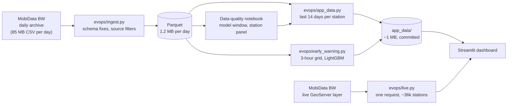

# EV Charging Network Operations

**An operations dashboard for public EV charging in Germany: which stations are down right now, which outages are chronic, which operator feeds can't be trusted, and which working stations are likely to fail this week.**

[](https://tejas-ev-charging-ops.streamlit.app/)


**Live:** [tejas-ev-charging-ops.streamlit.app](https://tejas-ev-charging-ops.streamlit.app/)


## The problem

A charging-network operations team starts the day with one question: *what needs fixing first?* The public data looks simple (each station reports how many charge points are available, charging or out of service), but taken at face value it misleads in two ways:

1. **Stale feeds look like outages.** When an operator's feed stops updating, its last status stays frozen. In a live snapshot on 9 Oct 2026, **43% of out-of-service charge points sat behind feeds the platform itself flags as outdated**. Counting them as broken would put whole operators at the top of the outage list for a reporting problem, not a hardware one.
2. **Months of the archive are unreliable.** Before July 2026, many operators reported most charge points as "unknown". "Unknown" peaked at **86% of charge points on 19 May 2026**.
3. **Closed is not broken.** About 900 Lidl chargers, and others at supermarkets, are switched off when the store closes, at night and all Sunday. The feed reports them as out of service. The project learns each station's weekly closing pattern from its own history and doesn't count those hours as outages.

This project handles all three before showing or modelling anything.

## What the dashboard does

| Question | How it's answered |
|---|---|
| Which stations need attention now? | Stations with charge points out of service **and a fresh feed**, ranked by estimated capacity offline (points down × the station's maximum power), so a dead fast-charging hub outranks a car park of slow wallboxes. |
| Is this a new outage or a chronic one? | "Days down": how many of the last 14 days the station had an outage, from the daily archive. |
| Which working stations will fail this week? | A LightGBM forecast of the chance each working station reports an outage in the next 7 days, tested on weeks the model never saw (see below). |
| Which feeds can't be trusted? | Stations behind outdated feeds (about 14%) are shown as "Feed quiet", kept out of the outage list, and summarised by operator. |
| Is it closed or broken? | Stations out of service during their usual closing hours are shown as "Scheduled closure", not as outages. |
| Where are the problems? | Map of every live station, coloured by state, with filters for operator, city and fast chargers. |
| How has the network behaved? | Per-station and network-wide history, with the data-quality periods excluded from modelling marked. |

Live data refreshes at most every 10 minutes and covers about **35,600 stations and 100,000+ charge points** across Germany.

## Key findings

From [`notebooks/01_data_quality.ipynb`](notebooks/01_data_quality.ipynb), on 248 days of archive (28 Jan – 2 Oct 2026):

- **93 of 248 days fail the data-quality bar** (more than 15% of charge points "unknown") and are excluded, even on days when coverage looked fine.
- **Only 46 days are fit for an hourly model: 30 June – 14 August 2026.** That is the one stretch with Germany-wide coverage (≥ 20,000 stations), at least hourly capture and ≤ 15% unknown status.
- **A fixed panel of 23,357 stations** (68% of the 34,118 seen in that window) reports on at least 90% of its days. Models use only this panel, so operators joining or leaving the feed don't look like changes in demand.
- In that window, **7.9% of live charge points were out of service on an average day.**

## Outage early warning (Phase 3)

**Question:** of the stations working right now, which will report an outage in the next 7 days? Code: [`evops/early_warning.py`](evops/early_warning.py), full results: [`reports/early_warning.md`](reports/early_warning.md).

- **Features** use only the 21 days before the forecast date: how often the station failed, share of time down, days since the last outage, usage trend, unknown-status share, station size and power, and the operator's network-wide outage rate.
- **Label:** an unexpected outage (outside scheduled closures) seen in at least two 3-hour blocks of the next 7 days, so single blips don't count.
- **Comparable over time:** the archive's capture rate drops from every few minutes (summer) to every ~2.5 hours (September). Every station is sampled once per 3-hour block, so both periods look alike to the model.
- **Validation is time-based only:** trained on six forecast dates in late July, tested on the following unseen week and, separately, on three weeks in September with no retraining.

| Test (share of stations that had an outage) | Model | AUC | Of the 100 riskiest, had an outage |
|---|---|---|---|
| Week of 7 Aug (16%) | Rule: share of time down, last 21 days | 0.811 | 38% |
| | Rule: how often it failed, last 21 days | 0.840 | 99% |
| | **LightGBM** | **0.847** | **100%** |
| Three weeks in September (25%) | Rule: share of time down, last 21 days | 0.845 | 52% |
| | Rule: how often it failed, last 21 days | 0.857 | 94% |
| | **LightGBM** | **0.870** | **96%** |
| Stations with no outage in the past 21 days (4%) | **LightGBM** | **0.576** | 5% |

**What this shows, honestly:** LightGBM is the best model in both tests and holds up in September without retraining, but it is only slightly ahead of a well-chosen rule. **How often a station failed recently is by far the strongest signal**: stations with intermittent faults keep failing. First-time failures are barely predictable from this data (AUC 0.58). The practical value is a short, reliable list of stations with recurring faults for a maintenance team to check first.

**First attempt that didn't work:** I first tried to detect "silent failures", stations that report "available" but where nobody charges for far longer than usual. Long, unusual idle spells ended with someone charging 84–87% of the time, the same rate as ordinary ones, and flagged stations were no more likely to report an outage later. Without repair records, a silent failure can't be told apart from a quiet day, so it was dropped. The code stays in [`evops/silent_failure.py`](evops/silent_failure.py) as a documented negative result.

## How it works



- **Ingestion** turns each day's 85 MB CSV into a 1.2 MB Parquet file. It handles schema changes in the archive (a renamed ID column in June, a new staleness flag in September) and drops the federal register's static rows and Swiss stations.
- **Live data** comes from the same layer the archive snapshots, in one request (about 9 MB, a few seconds), so live and history share one format and no paging is needed.
- **The deployed app** needs no database: it reads the live layer directly and a small history pack committed to the repo.

## Tech stack

Python · pandas · PyArrow / Parquet · LightGBM · scikit-learn · Streamlit · Plotly · pydeck · Jupyter · Streamlit Community Cloud

## Roadmap

- [x] **Phase 1:** ingestion pipeline and data-quality analysis
- [x] **Phase 2:** live operations dashboard, deployed
- [x] **Phase 3:** outage early warning (LightGBM), validated on unseen weeks; silent-failure detection tested and dropped
- [ ] **Phase 4:** next-hour forecast: which stations will have no free charge point in the next hour

## Run it locally

```bash
pip install -r requirements.txt
python -m evops.check_feeds                 # checks the feeds, writes reports/feed_check.md
python -m evops.ingest --start 2026-01-28   # downloads and converts the archive (~100 MB of Parquet)
jupyter nbconvert --to notebook --execute --inplace notebooks/01_data_quality.ipynb
python -m evops.app_data                    # packs the last 14 days into app_data/
python -m evops.early_warning evaluate      # backtests, writes reports/early_warning.md
python -m evops.early_warning predict       # retrains on all data, writes app_data/risk.parquet and closures.parquet
streamlit run app/streamlit_app.py          # opens the dashboard
```

To run just the dashboard, skip the middle steps: `app_data/` is already in the repo, so `pip install -r requirements.txt` and `streamlit run app/streamlit_app.py` work on a fresh clone.

## Project structure

```
app/          Streamlit dashboard
app_data/     small history pack the dashboard reads (committed)
evops/        pipeline: config, feed check, ingestion, live fetch, app data, early warning
models/       trained LightGBM model and its evaluation results
notebooks/    data-quality analysis
tools/        script that builds the notebook
docs/         screenshots
data/         downloaded and processed archive (git-ignored)
```

## Limits

- Models will train on 46 summer days. Winter behaviour (cold weather, holidays) is not in the training data, so forecasts may need retraining for winter.
- Only stations whose operators publish live status are included.
- The feed shows whether a charge point is occupied, not how many drivers wanted one, so the project ranks saturated stations rather than estimating unmet demand.
- History and the outage forecast on the deployed app update when `app_data/` is rebuilt and committed; live status is always current.
- The forecast can't see causes the feed doesn't report (vandalism, grid work, software updates), and it can't tell a hardware fault from a feed glitch that reports one.

<details>
<summary><strong>Decisions log</strong></summary>

- 2026-10-04: Chose MobiData BW over scraping app data: open licence, live status and a daily archive.
- 2026-10-04: Archive check: Germany-wide (Swiss stations dropped); snapshot time = `datastore_updated_at`, because `status_last_updated` is stamped at export time. One day = 85 MB CSV, 1.2 MB Parquet.
- 2026-10-04: Excluded `bnetza_api` (static register, no live status; dumped ~58k static rows on 14–15 Sep). Capture frequency per station changes over the archive (~90/day early Aug, ~10/day mid-Aug to 27 Sep, ~26/day from 28 Sep), logged per day in `data/processed/manifest.csv`; models must resample to a fixed hourly grid.
- 2026-10-05: Modelling window 30 Jun – 14 Aug 2026 (46 days). Rule: ≥ 20,000 stations, ≥ 24 snapshots per station, ≤ 15% unknown status, gaps ≤ 2 days. Station panel: 23,357 stations present on ≥ 90% of window days.
- 2026-10-05: The notebook summarises the archive one day at a time with pandas + PyArrow instead of DuckDB, after Windows Smart App Control blocked DuckDB's compiled library. Same results, no special dependencies.
- 2026-10-09: Live data from MobiData BW's GeoServer `charge_points` layer: one CSV request returns every station in the same columns as the archive. DATEX II and OCPI need paging and are kept as fallbacks.
- 2026-10-09: Stale feeds are separated, not counted as outages. `status_last_updated` is not used for outage duration, because fresh feeds re-stamp it on every report; outage history comes from the daily archive instead.
- 2026-10-12: Dashboard deployed on Streamlit Community Cloud.
- 2026-10-12: Outages ranked by estimated capacity offline (points down × station maximum power) instead of points down. The first version put a 195-point site of 11 kW chargers above fully down 250 kW supercharger sites.
- 2026-10-13: Silent-failure detection dropped: high-surprise idle spells ended with a charge as often as ordinary ones, and flagged stations failed no more often later. Moved to a supervised outage early warning, where outcomes can be checked.
- 2026-10-13: Found ~900 Lidl chargers reported out of service every night and all Sunday (store hours). Scheduled closures are learned per station (3-hour block of the week out of service ≥ 75% of the lookback while open elsewhere) and excluded from labels, features and the live outage list. Results were stable with a 60% threshold.
- 2026-10-13: Early warning built on a 3-hour grid (one snapshot per station and block), so dense summer and sparse September data are comparable. LightGBM beats both rules but only narrowly beats "how often it failed in the last 21 days"; this is reported as is.

</details>

## Data and attribution

Data: MobiData BW (NVBW), "Gebündelte Daten E-Ladesäulen Baden-Württemberg", https://mobidata-bw.de/dataset/e-ladesaulen, licence [dl-de/by-2-0](https://www.govdata.de/dl-de/by-2-0). Includes data from EnBW AG and Bundesnetzagentur (CC BY 4.0). Data was aggregated and modified for this project. Despite the dataset's name, it covers stations across Germany. No scraping, no personal data. Not affiliated with any operator.

Code: MIT licence.
