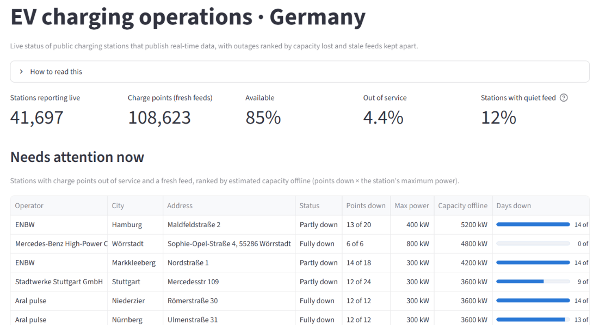
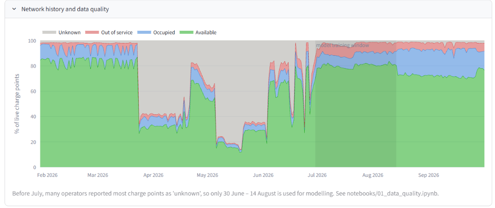
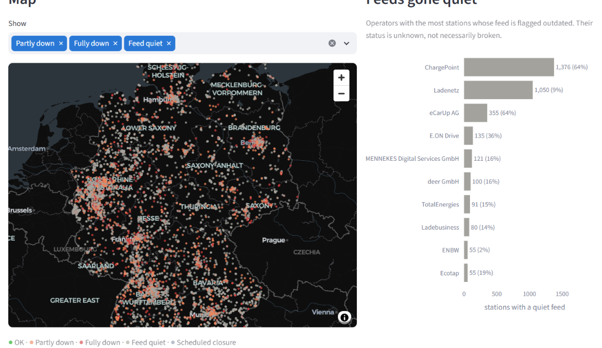
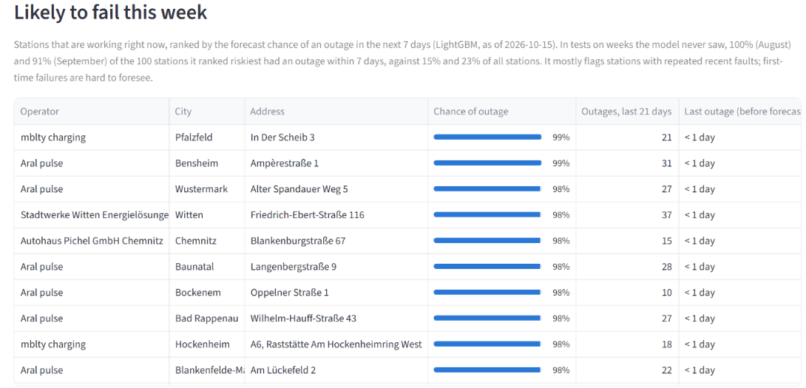
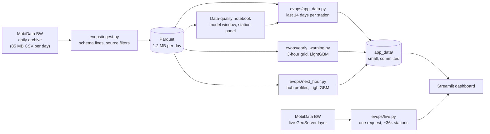

# EV Charging Network Operations

**A live operations dashboard for public EV charging in Germany, with two validated machine-learning forecasts: which working stations will fail this week, and which fast-charging hubs are about to fill up.**

[](https://tejas-ev-charging-ops.streamlit.app/)


**Live dashboard:** [tejas-ev-charging-ops.streamlit.app](https://tejas-ev-charging-ops.streamlit.app/)



## Overview

A charging-network operations team starts every day with the same questions: *what is broken, what needs fixing first, and where will drivers queue?* This project answers them from open, real-time data covering 35,000–39,000 public charging stations and more than 100,000 charge points across Germany.

It combines:

- **a data pipeline** that turns eight months of raw daily archives into clean, comparable Parquet files;
- **a live dashboard** that ranks outages by charging capacity lost and keeps unreliable data apart;
- **two LightGBM forecasts**, each tested on weeks the model never saw and benchmarked against simple rules.

### Highlights

- **Outage early warning:** AUC 0.85–0.86 on unseen weeks; of the 100 stations ranked riskiest, **91–100% had an outage within 7 days**, against a base rate of 15–23%.
- **Next-hour forecast for fast hubs:** for hubs that still have a free charge point, AUC 0.90–0.91, against 0.83–0.85 for the hub's usual pattern.
- **Data quality first:** stale feeds, months of "unknown" status, changing capture rates and ~900 supermarket chargers whose store closures were reported as outages were all found and handled before modelling.
- **Honest benchmarks:** each model is compared with the strongest simple rule, and the README reports where the rule is just as good.

## The data and its traps

The source is [MobiData BW](https://mobidata-bw.de/dataset/e-ladesaulen): a live feed of every station's status (charge points available, charging, out of service, unknown) and a daily archive of snapshots since January 2026. Taken at face value, it misleads in four ways:

1. **Stale feeds look like outages.** When an operator's feed stops updating, its last status stays frozen. In a live snapshot, **43% of out-of-service charge points sat behind feeds the platform itself flags as outdated**. Counting them as broken would put whole operators at the top of the outage list for a reporting problem.
2. **Months of the archive are unreliable.** Before July 2026, many operators reported most charge points as "unknown", peaking at **86% on 19 May 2026**. 93 of 248 archive days fail a 15% "unknown" threshold.
3. **Closed is not broken.** About **900 Lidl chargers**, and others at supermarkets, are switched off when the store closes, at night and all Sunday, and the feed reports them as out of service. The project learns each station's weekly closing pattern, pooled by operator where a station's own data is thin, and doesn't count those hours as outages.
4. **The capture rate changes.** The archive records a station every few minutes in summer, only every ~2.5 hours from mid-August to late September, and about hourly after that. Models sample on fixed time grids so the periods are comparable.

From the data-quality analysis ([`notebooks/01_data_quality.ipynb`](notebooks/01_data_quality.ipynb)): only **30 June – 14 August 2026** combines Germany-wide coverage, at least hourly capture and ≤ 15% unknown status, and in that window **7.9% of live charge points were out of service on an average day**.



## The dashboard

| Section | What it shows |
|---|---|
| **Needs attention now** | Stations with charge points out of service and a fresh feed, ranked by estimated capacity offline (points down × maximum power), so a dead fast-charging hub outranks a car park of slow wallboxes. "Days down" shows how many of the last 14 days each station had an outage, separating chronic problems from new ones. |
| **Likely to fail this week** | Working stations ranked by their forecast chance of an outage in the next 7 days. |
| **Fast hubs about to fill up** | Fast-charging hubs with a free charge point now, ranked by how likely they are to have none in about an hour, computed live. |
| **Map** | Every live station coloured by state: OK, partly down, fully down, feed quiet, scheduled closure. |
| **Feeds gone quiet** | Operators with the most stations behind outdated feeds, shown separately rather than counted as broken. |
| **History** | Per-station and network-wide history, with the data-quality periods excluded from modelling marked. |

Filters for operator, city and fast chargers apply throughout. Live data refreshes every 10 minutes.



## Forecast 1: outage early warning

**Question:** of the stations working right now, which will report an outage in the next 7 days?

- **Features** use only the 21 days before the forecast date: how often the station failed, share of time down, days since the last outage, usage trend, unknown-status share, station size and power, and the operator's network-wide outage rate.
- **Who is scored:** stations working at the forecast date that were also working most of the previous week. Stations down most of the week are chronic cases for the live outage list.
- **Label:** an unexpected outage (outside scheduled closures) seen in at least two 3-hour blocks of the next 7 days, so single blips don't count.
- **Validation:** time-based only. Trained on six forecast dates in late July, tested on the following unseen week and, without retraining, on three weeks in September under a different capture regime.



| Test (share of stations with an outage) | Model | AUC | Of the 100 riskiest, had an outage |
|---|---|---|---|
| Week of 7 Aug (15%) | Rule: share of time down, last 21 days | 0.808 | 23% |
| | Rule: how often it failed, last 21 days | 0.835 | 99% |
| | **LightGBM** | **0.845** | **100%** |
| Three weeks in September (23%) | Rule: share of time down, last 21 days | 0.835 | 32% |
| | Rule: how often it failed, last 21 days | 0.845 | 93% |
| | **LightGBM** | **0.857** | **91%** |
| Stations with no outage in the past 21 days (4%) | **LightGBM** | **0.585** | 8% |

**Interpretation.** LightGBM has the best AUC in both tests and holds up in September without retraining, but it is only slightly ahead of a well-chosen rule. **How often a station failed recently is by far the strongest signal**: stations with intermittent faults keep failing. First-time failures are barely predictable from this data. The practical value is a short, reliable list of stations with recurring faults for a maintenance team to check first.

Code: [`evops/early_warning.py`](evops/early_warning.py) · Full results: [`reports/early_warning.md`](reports/early_warning.md)

## Forecast 2: fast hubs about to fill up

**Question:** will a fast-charging hub (≥ 50 kW, 2+ charge points) have no free charge point about an hour from now?

- **Inputs are limited to what the live app has:** one live snapshot of the hub, the time, and the hub's usual pattern by hour of the week. No trailing history is needed, so the forecast runs live in the dashboard.
- **Label:** the hub's state in the snapshot closest to 60 minutes later. "Full" means no free charge point while at least one is charging; a fully broken hub is an outage, not demand.
- **Validation:** trained on July (5.7 million hub-hours, 9,263 hubs), tested on 1–13 August and on 1–12 October, a different season and capture regime.

| Test (share full an hour later) | Model | AUC, all hubs | AUC, hubs with a free point now | Top 20 free hubs per hour: share that filled up |
|---|---|---|---|---|
| 1–13 Aug (1.2%) | Rule: full now, otherwise usual rate | 0.893 | 0.848 | 5.1% |
| | **LightGBM** | **0.926** | **0.912** | **12.4%** |
| 1–12 Oct (1.7%) | Rule: full now, otherwise usual rate | 0.897 | 0.827 | 7.0% |
| | **LightGBM** | **0.922** | **0.895** | **7.9%** |

**Interpretation.** A full hub stays full about half the time, so "full now" is already a strong forecast, with slightly better average precision across all hubs than the model. The model's value is for hubs that are free right now, where it ranks clearly better than the hub's usual pattern. Full hubs are rare (1–2% of hub-hours), so even the top picks mostly stay free, and in October they were only slightly better than the rule's. The dashboard therefore shows a ranking score rather than a promised probability.

The model is trained with **monotone constraints** (more free charge points can only lower the score; a hub that is usually full at that hour can only raise it). Without them, an unconstrained version learned a spike for one narrow feature value and gave some idle, never-full hubs a high score in the live app. The constrained model removed that and scored better in both tests.

Code: [`evops/next_hour.py`](evops/next_hour.py) · Full results: [`reports/next_hour.md`](reports/next_hour.md)

## What didn't work

The first modelling idea was to detect **silent failures**: stations that report "available" while nobody charges there for far longer than their usual pattern suggests, such as a broken payment terminal or a blocked bay. The detector flagged plenty of unusual idle spells, but they ended with someone charging 84–87% of the time, the same rate as ordinary idle spells, and flagged stations were no more likely to report an outage later. Without repair records, a silent failure can't be told apart from a quiet day, so the approach was dropped in favour of the outage early warning, where outcomes can be checked. The code is kept in [`evops/silent_failure.py`](evops/silent_failure.py) as a documented negative result.

## Architecture



- **Ingestion** turns each day's 85 MB CSV into a 1.2 MB Parquet file, handles schema changes in the archive (a renamed ID column, a staleness flag added later), drops static register rows and Swiss stations, and re-checks recent days that were only partly published.
- **Live data** comes from the layer the archive snapshots, in one request of about 9 MB, so live and historical data share one format and no paging is needed.
- **The deployed app** needs no database: it reads the live layer directly, plus a small pack of history, forecasts and models committed to the repo.

## Key design decisions

- **Open data over scraping:** MobiData BW offers an open licence, live status and a daily archive.
- **Stale feeds are separated, not counted as outages,** and the feed's "last updated" field is not used for outage duration, because fresh feeds re-stamp it on every report. Outage history comes from the archive instead.
- **Outages are ranked by capacity offline,** not by points down. The first version put a 195-point site of 11 kW chargers above fully down 250 kW supercharger hubs.
- **Scheduled closures are learned, not hard-coded:** a 3-hour block of the week counts as closed if a station is out of service there at least 75% of the time while clearly open at other times, with the operator's pooled pattern filling gaps. Results were stable with a 60% threshold.
- **Fixed time grids** (3-hour blocks for the early warning, hourly samples for the next-hour forecast) make dense summer and sparse autumn data comparable.
- **Time-based validation only,** with an out-of-season test for both models and simple rules as benchmarks.
- **Forecast inputs match what is available live,** so the next-hour model can run inside the dashboard.
- **Monotone constraints on the next-hour model,** so its scores always move in the common-sense direction: a live check found idle hubs that are never full ranked near the top before the constraints were added.

## Limitations

- Training data covers summer and early autumn 2026. Winter behaviour (cold weather, holidays) is not represented, so the models would need retraining for winter.
- Only stations whose operators publish live status are included.
- The feed shows whether a charge point is occupied, not how many drivers wanted one, so the project ranks saturated hubs rather than estimating unmet demand.
- The forecasts can't see causes the feed doesn't report (vandalism, grid work, software updates), and can't tell a hardware fault from a feed glitch that reports one.
- History and forecasts on the deployed app update when `app_data/` and `models/` are rebuilt and committed; live status is always current.

## Run it locally

To run just the dashboard, a fresh clone is enough, because `app_data/` and `models/` are in the repo:

```bash
pip install -r requirements.txt
streamlit run app/streamlit_app.py
```

To rebuild everything from the raw archive:

```bash
python -m evops.check_feeds                 # checks the feeds, writes reports/feed_check.md
python -m evops.ingest --start 2026-01-28   # downloads and converts the archive (~100 MB of Parquet)
jupyter nbconvert --to notebook --execute --inplace notebooks/01_data_quality.ipynb
python -m evops.app_data                    # packs the last 14 days into app_data/
python -m evops.early_warning evaluate      # backtests, writes reports/early_warning.md
python -m evops.early_warning predict       # retrains, writes the outage forecast and closure patterns
python -m evops.next_hour evaluate          # backtests, writes reports/next_hour.md
python -m evops.next_hour predict           # retrains, writes the next-hour model and hub profiles
```

To refresh the data and forecasts later, run `python -m evops.ingest`, then `app_data`, then both `predict` commands.

## Project structure

```
app/          Streamlit dashboard
app_data/     history, forecasts and profiles the dashboard reads (committed)
evops/        pipeline: config, feed check, ingestion, live fetch, app data, both forecasts
models/       trained LightGBM models and their evaluation results
notebooks/    data-quality analysis
reports/      generated evaluation reports
tools/        script that builds the notebook
docs/         screenshots
data/         downloaded and processed archive (git-ignored)
```

## Tech stack

Python · pandas · PyArrow / Parquet · LightGBM · scikit-learn · Streamlit · Plotly · pydeck · Jupyter · Git · Streamlit Community Cloud

## Data and attribution

Data: MobiData BW (NVBW), "Gebündelte Daten E-Ladesäulen Baden-Württemberg", https://mobidata-bw.de/dataset/e-ladesaulen, licence [dl-de/by-2-0](https://www.govdata.de/dl-de/by-2-0). Includes data from EnBW AG and Bundesnetzagentur (CC BY 4.0). Data was aggregated and modified for this project. Despite the dataset's name, it covers stations across Germany. No scraping, no personal data. Not affiliated with any operator.

## Author

**Tejas Manjunath**, MSc Business Intelligence & Data Science (AI specialisation), ISM Dortmund · [GitHub](https://github.com/TejasManjunath)

Code released under the MIT licence.
