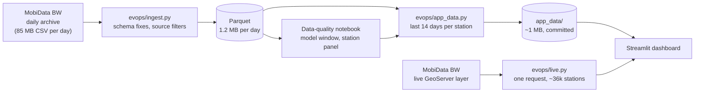

# EV Charging Network Operations

**An operations dashboard for public EV charging in Germany: which stations are down right now, which outages are chronic, and which operator feeds can't be trusted.**

[](https://tejas-ev-charging-ops.streamlit.app/)


**Live:** [tejas-ev-charging-ops.streamlit.app](https://tejas-ev-charging-ops.streamlit.app/)


## The problem

A charging-network operations team starts the day with one question: *what needs fixing first?* The public data looks simple (each station reports how many charge points are available, charging or out of service), but taken at face value it misleads in two ways:

1. **Stale feeds look like outages.** When an operator's feed stops updating, its last status stays frozen. In a live snapshot on 9 Oct 2026, **43% of out-of-service charge points sat behind feeds the platform itself flags as outdated**. Counting them as broken would put whole operators at the top of the outage list for a reporting problem, not a hardware one.
2. **Months of the archive are unreliable.** Before July 2026, many operators reported most charge points as "unknown". "Unknown" peaked at **86% of charge points on 19 May 2026**.

This project handles both before showing or modelling anything.

## What the dashboard does

| Question | How it's answered |
|---|---|
| Which stations need attention now? | Stations with charge points out of service **and a fresh feed**, ranked by estimated capacity offline (points down × the station's maximum power), so a dead fast-charging hub outranks a car park of slow wallboxes. |
| Is this a new outage or a chronic one? | "Days down": how many of the last 14 days the station had an outage, from the daily archive. |
| Which feeds can't be trusted? | Stations behind outdated feeds (about 14%) are shown as "Feed quiet", kept out of the outage list, and summarised by operator. |
| Where are the problems? | Map of every live station, coloured by state, with filters for operator, city and fast chargers. |
| How has the network behaved? | Per-station and network-wide history, with the data-quality periods excluded from modelling marked. |

Live data refreshes at most every 10 minutes and covers about **35,600 stations and 100,000+ charge points** across Germany.

## Key findings

From [`notebooks/01_data_quality.ipynb`](notebooks/01_data_quality.ipynb), on 248 days of archive (28 Jan – 2 Oct 2026):

- **93 of 248 days fail the data-quality bar** (more than 15% of charge points "unknown") and are excluded, even on days when coverage looked fine.
- **Only 46 days are fit for an hourly model: 30 June – 14 August 2026.** That is the one stretch with Germany-wide coverage (≥ 20,000 stations), at least hourly capture and ≤ 15% unknown status.
- **A fixed panel of 23,357 stations** (68% of the 34,118 seen in that window) reports on at least 90% of its days. Models use only this panel, so operators joining or leaving the feed don't look like changes in demand.
- In that window, **7.9% of live charge points were out of service on an average day.**

## How it works



- **Ingestion** turns each day's 85 MB CSV into a 1.2 MB Parquet file. It handles schema changes in the archive (a renamed ID column in June, a new staleness flag in September) and drops the federal register's static rows and Swiss stations.
- **Live data** comes from the same layer the archive snapshots, in one request (about 9 MB, a few seconds), so live and history share one format and no paging is needed.
- **The deployed app** needs no database: it reads the live layer directly and a small history pack committed to the repo.

## Tech stack

Python · pandas · PyArrow / Parquet · Streamlit · Plotly · pydeck · Jupyter · Streamlit Community Cloud

## Roadmap

- [x] **Phase 1:** ingestion pipeline and data-quality analysis
- [x] **Phase 2:** live operations dashboard, deployed
- [ ] **Phase 3:** anomaly detection: flag stations behaving unlike their own normal pattern
- [ ] **Phase 4:** next-hour forecast: which stations will have no free charge point in the next hour

## Run it locally

```bash
pip install -r requirements.txt
python -m evops.check_feeds                 # checks the feeds, writes reports/feed_check.md
python -m evops.ingest --start 2026-01-28   # downloads and converts the archive (~100 MB of Parquet)
jupyter nbconvert --to notebook --execute --inplace notebooks/01_data_quality.ipynb
python -m evops.app_data                    # packs the last 14 days into app_data/
streamlit run app/streamlit_app.py          # opens the dashboard
```

To run just the dashboard, skip the middle steps: `app_data/` is already in the repo, so `pip install -r requirements.txt` and `streamlit run app/streamlit_app.py` work on a fresh clone.

## Project structure

```
app/          Streamlit dashboard
app_data/     small history pack the dashboard reads (committed)
evops/        pipeline: config, feed check, ingestion, live fetch, app data
notebooks/    data-quality analysis
tools/        script that builds the notebook
docs/         screenshots
data/         downloaded and processed archive (git-ignored)
```

## Limits

- Models will train on 46 summer days. Winter behaviour (cold weather, holidays) is not in the training data, so forecasts may need retraining for winter.
- Only stations whose operators publish live status are included.
- The feed shows whether a charge point is occupied, not how many drivers wanted one, so the project ranks saturated stations rather than estimating unmet demand.
- History on the deployed app updates when `app_data/` is rebuilt and committed; live status is always current.

<details>
<summary><strong>Decisions log</strong></summary>

- 2026-10-04: Chose MobiData BW over scraping app data: open licence, live status and a daily archive.
- 2026-10-04: Archive check: Germany-wide (Swiss stations dropped); snapshot time = `datastore_updated_at`, because `status_last_updated` is stamped at export time. One day = 85 MB CSV, 1.2 MB Parquet.
- 2026-10-04: Excluded `bnetza_api` (static register, no live status; dumped ~58k static rows on 14–15 Sep). Capture frequency per station changes over the archive (~90/day early Aug, ~10/day mid-Aug to 27 Sep, ~26/day from 28 Sep), logged per day in `data/processed/manifest.csv`; models must resample to a fixed hourly grid.
- 2026-10-05: Modelling window 30 Jun – 14 Aug 2026 (46 days). Rule: ≥ 20,000 stations, ≥ 24 snapshots per station, ≤ 15% unknown status, gaps ≤ 2 days. Station panel: 23,357 stations present on ≥ 90% of window days.
- 2026-10-05: The notebook summarises the archive one day at a time with pandas + PyArrow instead of DuckDB, after Windows Smart App Control blocked DuckDB's compiled library. Same results, no special dependencies.
- 2026-10-09: Live data from MobiData BW's GeoServer `charge_points` layer: one CSV request returns every station in the same columns as the archive. DATEX II and OCPI need paging and are kept as fallbacks.
- 2026-10-09: Stale feeds are separated, not counted as outages. `status_last_updated` is not used for outage duration, because fresh feeds re-stamp it on every report; outage history comes from the daily archive instead.
- 2026-10-12: Dashboard deployed on Streamlit Community Cloud.
- 2026-10-12: Outages ranked by estimated capacity offline (points down × station maximum power) instead of points down. The first version put a 195-point site of 11 kW chargers above fully down 250 kW supercharger sites.

</details>

## Data and attribution

Data: MobiData BW (NVBW), "Gebündelte Daten E-Ladesäulen Baden-Württemberg", https://mobidata-bw.de/dataset/e-ladesaulen, licence [dl-de/by-2-0](https://www.govdata.de/dl-de/by-2-0). Includes data from EnBW AG and Bundesnetzagentur (CC BY 4.0). Data was aggregated and modified for this project. Despite the dataset's name, it covers stations across Germany. No scraping, no personal data. Not affiliated with any operator.

Code: MIT licence.
# EV Charging Network Operations

**An operations dashboard for public EV charging in Germany: which stations are down right now, which outages are chronic, and which operator feeds can't be trusted.**

[](https://tejas-ev-charging-ops.streamlit.app/)


**Live:** [tejas-ev-charging-ops.streamlit.app](https://tejas-ev-charging-ops.streamlit.app/)


## The problem

A charging-network operations team starts the day with one question: *what needs fixing first?* The public data looks simple (each station reports how many charge points are available, charging or out of service), but taken at face value it misleads in two ways:

1. **Stale feeds look like outages.** When an operator's feed stops updating, its last status stays frozen. In a live snapshot on 9 Oct 2026, **43% of out-of-service charge points sat behind feeds the platform itself flags as outdated**. Counting them as broken would put whole operators at the top of the outage list for a reporting problem, not a hardware one.
2. **Months of the archive are unreliable.** Before July 2026, many operators reported most charge points as "unknown". "Unknown" peaked at **86% of charge points on 19 May 2026**.

This project handles both before showing or modelling anything.

## What the dashboard does

| Question | How it's answered |
|---|---|
| Which stations need attention now? | Stations with charge points out of service **and a fresh feed**, ranked by estimated capacity offline (points down × the station's maximum power), so a dead fast-charging hub outranks a car park of slow wallboxes. |
| Is this a new outage or a chronic one? | "Days down": how many of the last 14 days the station had an outage, from the daily archive. |
| Which feeds can't be trusted? | Stations behind outdated feeds (about 14%) are shown as "Feed quiet", kept out of the outage list, and summarised by operator. |
| Where are the problems? | Map of every live station, coloured by state, with filters for operator, city and fast chargers. |
| How has the network behaved? | Per-station and network-wide history, with the data-quality periods excluded from modelling marked. |

Live data refreshes at most every 10 minutes and covers about **35,600 stations and 100,000+ charge points** across Germany.

## Key findings

From [`notebooks/01_data_quality.ipynb`](notebooks/01_data_quality.ipynb), on 248 days of archive (28 Jan – 2 Oct 2026):

- **93 of 248 days fail the data-quality bar** (more than 15% of charge points "unknown") and are excluded, even on days when coverage looked fine.
- **Only 46 days are fit for an hourly model: 30 June – 14 August 2026.** That is the one stretch with Germany-wide coverage (≥ 20,000 stations), at least hourly capture and ≤ 15% unknown status.
- **A fixed panel of 23,357 stations** (68% of the 34,118 seen in that window) reports on at least 90% of its days. Models use only this panel, so operators joining or leaving the feed don't look like changes in demand.
- In that window, **7.9% of live charge points were out of service on an average day.**

## How it works


- **Ingestion** turns each day's 85 MB CSV into a 1.2 MB Parquet file. It handles schema changes in the archive (a renamed ID column in June, a new staleness flag in September) and drops the federal register's static rows and Swiss stations.
- **Live data** comes from the same layer the archive snapshots, in one request (about 9 MB, a few seconds), so live and history share one format and no paging is needed.
- **The deployed app** needs no database: it reads the live layer directly and a small history pack committed to the repo.

## Tech stack

Python · pandas · PyArrow / Parquet · Streamlit · Plotly · pydeck · Jupyter · Streamlit Community Cloud

## Roadmap

- [x] **Phase 1:** ingestion pipeline and data-quality analysis
- [x] **Phase 2:** live operations dashboard, deployed
- [ ] **Phase 3:** anomaly detection: flag stations behaving unlike their own normal pattern
- [ ] **Phase 4:** next-hour forecast: which stations will have no free charge point in the next hour

## Run it locally

```bash
pip install -r requirements.txt
python -m evops.check_feeds                 # checks the feeds, writes reports/feed_check.md
python -m evops.ingest --start 2026-01-28   # downloads and converts the archive (~100 MB of Parquet)
jupyter nbconvert --to notebook --execute --inplace notebooks/01_data_quality.ipynb
python -m evops.app_data                    # packs the last 14 days into app_data/
streamlit run app/streamlit_app.py          # opens the dashboard
```

To run just the dashboard, skip the middle steps: `app_data/` is already in the repo, so `pip install -r requirements.txt` and `streamlit run app/streamlit_app.py` work on a fresh clone.

## Project structure

```
app/          Streamlit dashboard
app_data/     small history pack the dashboard reads (committed)
evops/        pipeline: config, feed check, ingestion, live fetch, app data
notebooks/    data-quality analysis
tools/        script that builds the notebook
docs/         screenshots
data/         downloaded and processed archive (git-ignored)
```

## Limits

- Models will train on 46 summer days. Winter behaviour (cold weather, holidays) is not in the training data, so forecasts may need retraining for winter.
- Only stations whose operators publish live status are included.
- The feed shows whether a charge point is occupied, not how many drivers wanted one, so the project ranks saturated stations rather than estimating unmet demand.
- History on the deployed app updates when `app_data/` is rebuilt and committed; live status is always current.

<details>
<summary><strong>Decisions log</strong></summary>

- 2026-10-04: Chose MobiData BW over scraping app data: open licence, live status and a daily archive.
- 2026-10-04: Archive check: Germany-wide (Swiss stations dropped); snapshot time = `datastore_updated_at`, because `status_last_updated` is stamped at export time. One day = 85 MB CSV, 1.2 MB Parquet.
- 2026-10-04: Excluded `bnetza_api` (static register, no live status; dumped ~58k static rows on 14–15 Sep). Capture frequency per station changes over the archive (~90/day early Aug, ~10/day mid-Aug to 27 Sep, ~26/day from 28 Sep), logged per day in `data/processed/manifest.csv`; models must resample to a fixed hourly grid.
- 2026-10-05: Modelling window 30 Jun – 14 Aug 2026 (46 days). Rule: ≥ 20,000 stations, ≥ 24 snapshots per station, ≤ 15% unknown status, gaps ≤ 2 days. Station panel: 23,357 stations present on ≥ 90% of window days.
- 2026-10-05: The notebook summarises the archive one day at a time with pandas + PyArrow instead of DuckDB, after Windows Smart App Control blocked DuckDB's compiled library. Same results, no special dependencies.
- 2026-10-09: Live data from MobiData BW's GeoServer `charge_points` layer: one CSV request returns every station in the same columns as the archive. DATEX II and OCPI need paging and are kept as fallbacks.
- 2026-10-09: Stale feeds are separated, not counted as outages. `status_last_updated` is not used for outage duration, because fresh feeds re-stamp it on every report; outage history comes from the daily archive instead.
- 2026-10-12: Dashboard deployed on Streamlit Community Cloud.
- 2026-10-12: Outages ranked by estimated capacity offline (points down × station maximum power) instead of points down. The first version put a 195-point site of 11 kW chargers above fully down 250 kW supercharger sites.

</details>

## Data and attribution

Data: MobiData BW (NVBW), "Gebündelte Daten E-Ladesäulen Baden-Württemberg", https://mobidata-bw.de/dataset/e-ladesaulen, licence [dl-de/by-2-0](https://www.govdata.de/dl-de/by-2-0). Includes data from EnBW AG and Bundesnetzagentur (CC BY 4.0). Data was aggregated and modified for this project. Despite the dataset's name, it covers stations across Germany. No scraping, no personal data. Not affiliated with any operator.

Code: MIT licence.
